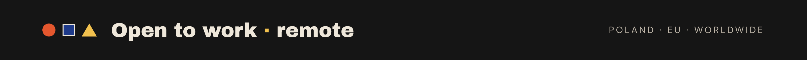

    

  
  
  

---

### ● At a glance

> **5+ years** shipping full-stack web and mobile products, the last three on a real-time cybersecurity platform.

- **Now** — real-time incident dashboards for MSPs and SOC teams, ~180K security events a day
- **Looking for** — Senior Full-Stack roles in remote teams (Poland, EU and worldwide)
- **Good fit for** — products where data never stops: monitoring, alerting, live feeds, B2B SaaS
- **Ask me about** — making heavy React tables fast · WebSocket over polling · RBAC · type-safe forms with Zod

### ■ Stack

| | |
|:--|:--|
| **Frontend** |        react-window · Uniforms · HTML5 · CSS |
| **Mobile** |     React Native Web · one codebase for desktop and mobile |
| **Backend** |      REST · WebSocket · Swagger · webhooks (Slack, MS Teams) |
| **Data** |    |
| **Security** | JWT · OAuth · Role-Based Access Control (RBAC) · multi-tenant setups |
| **Testing & infra** |         React Testing Library · Webpack |

### ▲ How I build

1. **Measure, then fix.** Slow screens get profiled first. That is how a live incidents table went from ~1.8 s to ~350 ms.
2. **Push, don't poll.** Real-time data should arrive in batches over WebSocket, not through a timer.
3. **Types at every border.** API payloads, forms and configs are checked with TypeScript and Zod, so mismatches fail early.
4. **Tests are part of the feature.** Unit, integration and end-to-end tests ship with the code, not after it.
5. **Teach as I review.** I mentor junior and mid-level engineers and keep code reviews quick and specific.

### ◆ Where I've worked

| | | |
|:--|:--|:--|
| **OAK'S LAB** | Senior Full-Stack | Blackpoint Cyber — real-time threat detection |
| **Monterail** | Middle Full-Stack | Cooleaf — employee engagement SaaS |
| **Vazco** | Junior Full-Stack | Uniforms — open-source form library |

  

